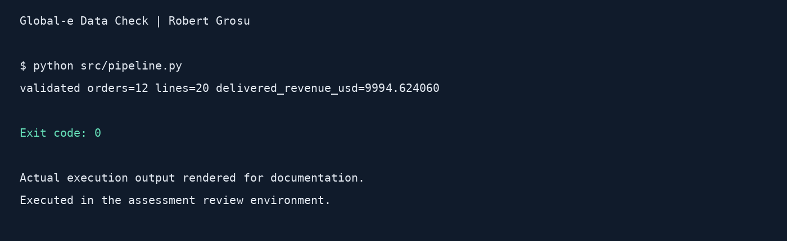
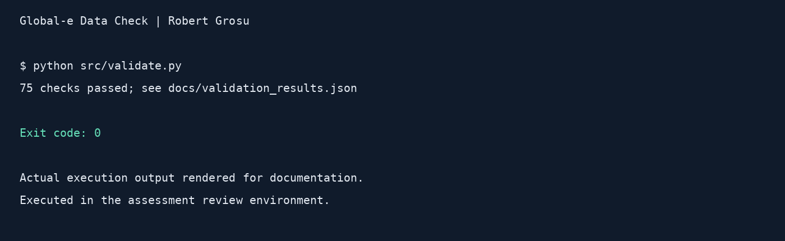

# Global-e Data Check

**Robert Grosu · BI Developer Technical Assessment**

[Open the dashboard](https://bitestgloabe.netlify.app/) · [SQL queries](sql/reporting_queries.sql) · [Data model](docs/star_schema.md) · [Results](data/output/reports/)

## What was the assignment?

Turn a retail ERP JSON export into data that can be used for reporting. The assessment required two flattened tables, a star schema, at least two documented data quality issues, four SQL reports, and a dashboard. It also required explanations of customer history, incremental loading, and AI usage.

## How I approached it

1. **Understand the data locally.** I started with the supplied JSON and worked through the processing logic and local SQL reports. I defined how to calculate revenue, convert currencies, handle order statuses, and keep customer history.
2. **Build a repeatable project with Codex.** Python reads and flattens the nested JSON. DuckDB stores the tables, and SQL builds the reporting results. Codex helped create the project structure, implementation, and documentation.
3. **Create the reporting page.** Codex and ChatGPT helped build the dashboard and Explanation tab. The page is hosted on Netlify, with the code kept in this GitHub repository.
4. **Check the results.** The pipeline was executed, and all four standalone SQL queries were compared with the exported report CSVs.

Python parses the JSON; SQL queries the structured data after loading. The website displays exported results from the local pipeline.

## Processing logic

The [pipeline](src/pipeline.py) reads the [original JSON](data/raw/orders_raw.json), checks its metadata count, and extracts every order and nested line item. Each line receives a number within its order.

Revenue is calculated using Decimal arithmetic:

```text
local revenue = quantity × unit_price × (1 − discount_pct / 100)
USD revenue   = local revenue × exchange rate
```

USD uses a rate of **1.00**. EUR uses the required fixed rate of **1.08**. Revenue is stored to six decimal places and displayed to two. Missing or null discounts become zero.

All source statuses are retained. All four reports use **Delivered orders only**; cancelled, returned, and processing orders are excluded from reported revenue. No refund transactions are invented. Shipping stays at order level and is excluded from line revenue.

## Warehouse model

| Table | What it contains |
|---|---|
| [orders](data/output/orders.csv) | One row per order, including customer details, status, currency, representative, and shipping |
| [order_lines](data/output/order_lines.csv) | One row per line, with prices, discounts, categories, exchange rate, and revenue |
| [dim_customer](data/output/dim_customer.csv) | Customer details and historical segment versions |
| [dim_product](data/output/dim_product.csv) | Products with standardized categories |
| [dim_date](data/output/dim_date.csv) | Date attributes from order timestamps in UTC |
| [fact_sales](data/output/fact_sales.csv) | One row per order line, linked to the three dimensions |

The natural line key is `(order_id, line_number)`. See the [star-schema diagram](docs/star_schema.md).

### Customer history and incremental loading

Sarah Mitchell changes from Premium to VIP, so the customer dimension keeps separate versions with a surrogate key and validity dates. This preserves the segment used at the time of each order, but adds lookup complexity; the first observed order date approximates the change date because no actual change timestamp is supplied. For daily appended files, I would preserve each input file and load only unseen `order_id` values, with unique order-line keys preventing duplicates. Changed orders would need an update or hash comparison; the current assessment pipeline performs a full rebuild.

## Data quality decisions

| Issue | Affected records | Decision |
|---|---|---|
| Inconsistent category casing | ORD-2024-006 / PROD-416 | Standardize `home appliances` to `Home Appliances` |
| Different categories for the same product | PROD-207: orders 003, 009, 011; PROD-214: orders 003, 012 | Map `Sports` and `Sports & Fitness` to `Sports & Fitness` |
| Unusual product price | ORD-2024-009 / PROD-207 | Flag €149.99 and retain it; the source does not prove it is wrong |

Raw category values are preserved. See the [data quality log](data/output/data_quality_log.csv).

## Reports and results

The [four SQL queries](sql/reporting_queries.sql) answer:

1. How does delivered revenue change by month?
2. Which products generate the most revenue, and what is each product's share?
3. How much revenue comes from each customer segment and channel?
4. How many delivered orders does each customer have, and how do customers rank by revenue?

[Read the SQL explanations](docs/sql_logic.md) or use the dashboard's **Explanation** tab.

| Validated result | Value |
|---|---:|
| Source orders | 12 |
| Source line items / fact rows | 20 / 20 |
| Delivered orders | 9 |
| Delivered revenue before display rounding | 9,994.624060 USD |
| Dashboard revenue | $9,994.62 |
| Report rows: monthly / product / segment-channel / customer | 7 / 8 / 5 / 6 |

All four standalone SQL results matched the [exported report CSVs](data/output/reports/). Customer order counts mean delivered orders. Q4 groups by customer name; include customer ID when extending to customers with duplicate names.

## Run it locally

```bash
python3 -m venv .venv
source .venv/bin/activate
python -m pip install -r requirements.txt
python src/pipeline.py
streamlit run src/dashboard.py
```

The pipeline rebuilds `data/warehouse/retail_bi.duckdb`, exports tables and reports to `data/output/`, and refreshes the website's CSV copies in `public/data/`.

The [online dashboard](https://bitestgloabe.netlify.app/) is a read-only page over those CSVs. It does not run a hosted DuckDB server. It includes charts, query-result tables, downloads, and an Explanation tab. [Netlify configuration](netlify.toml) publishes `public/`.

## AI usage

[Read the assessment conversation record](docs/chat_record.md). This is a reconstructed prompt and work log, not a full verbatim chat export.

I used **Codex and ChatGPT** for project setup, Python and SQL implementation support, review, documentation, and the dashboard. I supplied the processing walkthrough and SQL logic in the conversation and asked the tools to explain and present them. Useful prompts required reading the full assessment first, keeping the source unchanged, using a simple Python + DuckDB solution, and verifying outputs by executing the code.

The pipeline, four SQL comparisons, JavaScript syntax, dashboard rendering logic, and view-switching logic were checked. Full browser visual verification and a new screenshot remain outstanding. The customer history implementation covers the observed segment change; more general attribute changes and repeated segment reversions need additional handling.

**Before submission:** add the ChatGPT shared conversation link and any available Codex session link here. These links have not yet been supplied.

## Pipeline walkthrough and tests

Use the website's **Pipeline** tab for source files, requirements, cleaning and gold-layer logic. Use **Tests** to understand the checks and their limits.

- [Pipeline architecture diagram](docs/pipeline_architecture.md)
- [Executable validation](src/validate.py)
- [Saved results: 75 checks passed](docs/validation_results.json)

```bash
python src/pipeline.py
python src/validate.py
```

## Execution images

These images render actual successful command output from the assessment review environment; they are not desktop screenshots.




