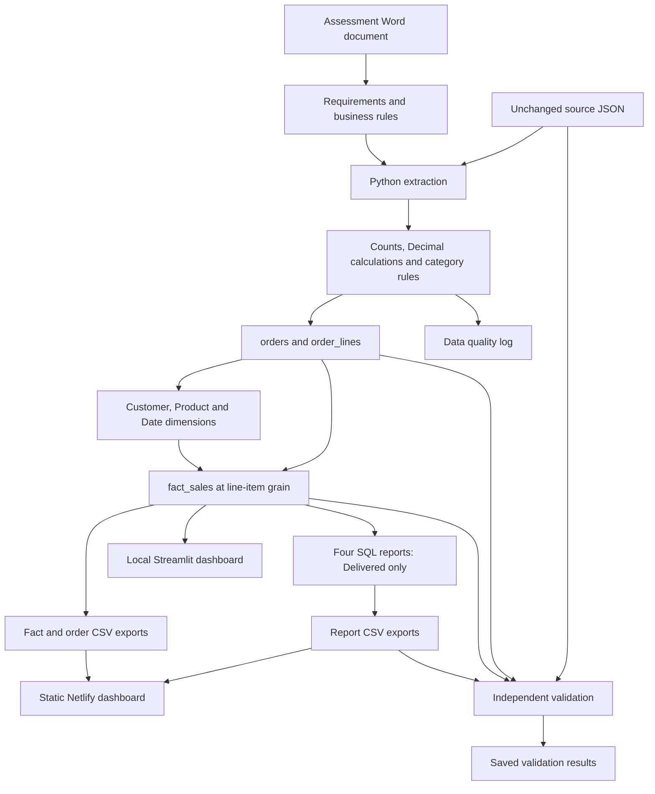

# Pipeline architecture

The raw, cleaned and gold labels describe logical stages in one local Python/DuckDB project.



## Reading the flow

1. The Word document supplies requirements; JSON supplies data.
2. Python preserves the input and flattens nested orders. It computes discounted revenue using Decimal, applies fixed currency rates and preserves raw categories beside normalized values.
3. DuckDB stores order-level and line-level tables, then builds dimensions and a fact table. Customer version lookups preserve Sarah's historical segment.
4. All statuses remain in the warehouse. Reports filter to Delivered. Shipping is not added to line revenue.
5. SQL results are exported to CSV; the public website reads these files. Netlify does not execute DuckDB queries.
6. The local Streamlit dashboard reads DuckDB directly. The validation script independently recalculates source revenue and compares source, warehouse and public outputs.

## Keys and grain

- orders: one row per order_id.
- order_lines and fact_sales: one row per (order_id, line_number).
- fact_sales links to customer_key, product_key and date_key.
- Customer dates use inclusive effective_from and exclusive effective_to.
- See [the detailed star schema](star_schema.md) for the dimension relationships.

## Reproduce and validate

```bash
python src/pipeline.py
python src/validate.py
```

The second command writes [validation_results.json](validation_results.json). It fails with an assertion if a check fails. These checks establish consistency with the supplied source and chosen business rules, not the real-world truth of the ERP prices. Missing/null discount behavior is documented in the pipeline but is not exercised by this source dataset, which has no null discounts.
