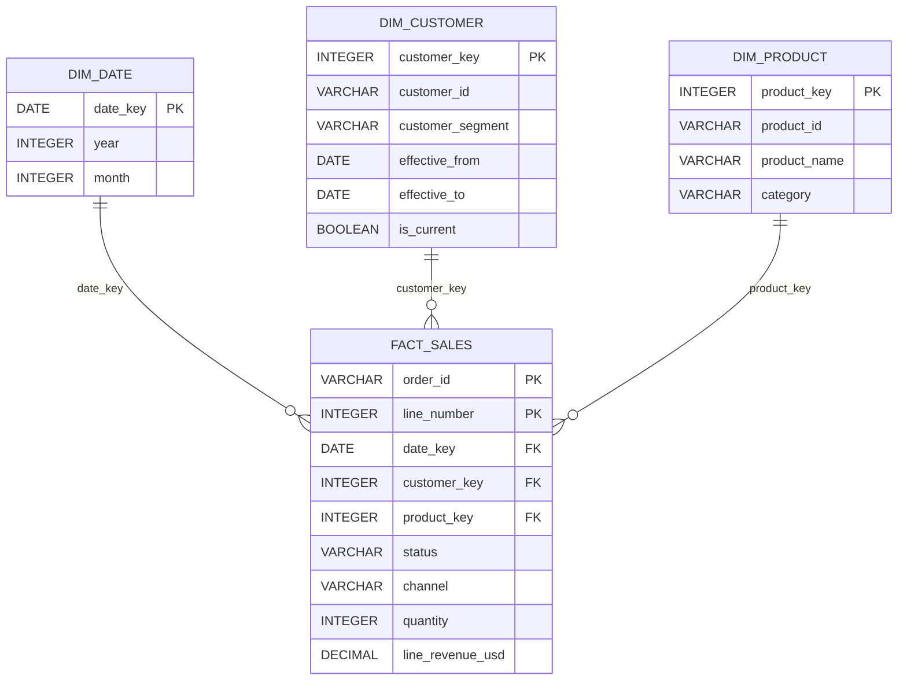

# Star schema

`fact_sales` has one row per source order line. `orders` and `order_lines` are the auditable flattened Task 1 tables; shipping stays at order grain and is intentionally not joined into the line-grain revenue fact.

